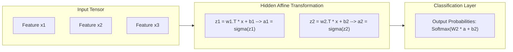

<p align="center">
  
</p>

<p align="center">
  
  
  
  
  
</p>

---

## Executive Summary / Overview
### Problem Statement & Context
Deep learning black boxes often obscure the foundational linear algebra, tensor contractions, and gradient mechanics that enable neural networks to learn representations. Understanding how forward propagation transforms input vectors across non-linear affine transformations is essential for debugging exploding gradients, vanishing signals, and architecture design flaws.

### Solution Overview
This repository presents a hands-on exploration of **Multi-Layer Perceptrons (MLPs)**, manual tensor mathematics for **Forward Propagation**, activation function non-linearities, and systematic training on real-world datasets (e.g., Iris classification). Additionally, it features research papers and formal documentation addressing the societal impact and ethical considerations of deep learning deployments.

---

## Interactive Table of Contents
- [Executive Summary / Overview](#executive-summary--overview)
- [Key Features & Capabilities](#key-features--capabilities)
- [System Architecture / Pipeline](#system-architecture--pipeline)
- [Tech Stack Breakdown](#tech-stack-breakdown)
- [Reproducible Quickstart & Setup](#reproducible-quickstart--setup)
- [Project Directory Layout](#project-directory-layout)
- [Author & Contributions](#author--contributions)

---

## Key Features & Capabilities
- **From-Scratch Forward Propagation:** Implementation of affine transformations Z = W * X + B followed by non-linear activations without relying on auto-grad abstractions.
- **Dataset Preprocessing & Scaling:** Robust feature standardization via `StandardScaler` to ensure numerical stability during matrix multiplications.
- **Multiclass Decision Boundaries:** Formulation of softmax activation for output probability distributions over distinct target classes.
- **Academic Research & AI Ethics:** Includes formal academic reports on *Ethical Considerations in Deep Learning* and *AI in Entertainment* (`.pdf`, `.docx`).

---

## System Architecture / Pipeline


---

## Tech Stack Breakdown
| Layer | Technology | Purpose |
| :--- | :--- | :--- |
| **Languages** | Python 3.10+ | Mathematical modeling and script execution |
| **Libraries** | NumPy, Scikit-Learn | Tensor array dot products, dataset loaders, preprocessing scalers |
| **Tools** | Matplotlib, Jupyter Notebook | Loss curves, decision boundaries, interactive verification |
| **Architecture** | Feedforward Multilayer Perceptron (MLP) | Layered affine mappings and activation non-linearities |

---

## Reproducible Quickstart & Setup
```bash
# 1. Clone repository
git clone https://github.com/suryateja-155/Deep-Learning.git
cd Deep-Learning

# 2. Virtual environment setup
python -m venv venv
.\venv\Scripts\activate   # On Windows

# 3. Install scientific packages
pip install numpy matplotlib scikit-learn notebook

# 4. Run the forward propagation experiments
jupyter notebook "Project_6_Neural_Network_Forward_Propagation (1).ipynb"
```

---

## Project Directory Layout
```text
Deep-Learning/
├── Project_6_Neural_Network_Forward_Propagation (1).ipynb   # Pure math forward pass implementation
├── Project_5 (1).ipynb                                     # Experimental neural network notebook
├── Ethical_Considerations_in_Deep_Learning.docx            # Treatise on AI safety, bias & fairness
├── AI_in_Entertainment (1).pdf                             # Domain study on generative media in entertainment
├── Project-3 DL.docx                                       # Deep learning experimental specification
└── README.md                                               # Technical documentation and mathematical guide
```

---

## Author & Contributions

**Gettupalli Surya Teja**  
- GitHub Profile: [@suryateja-155](https://github.com/suryateja-155)  
- Portfolio Index: [Gettupalli-Surya-Teja](https://github.com/suryateja-155/Gettupalli-Surya-Teja)

Contributions, issue reports, and feedback are always welcome! Feel free to open an issue or pull request.

<p align="center">
  
</p>
